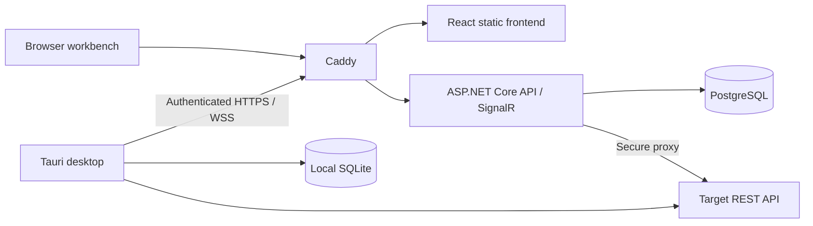

<p align="center">
  <picture>
    <source media="(prefers-color-scheme: dark)" srcset="frontend/public/branding/pakpost-logo-dark.svg">
    
  </picture>
</p>

<h1 align="center">PakPost API Workbench</h1>
<p align="center">A self-hostable REST API client for individual developers and collaborative teams.</p>
<p align="center">   </p>

PakPost combines a browser workbench and a native desktop app. Keep requests local, or connect to a shared workspace on a PakPost server you control. Version 0.1.0 is the initial feature-frozen REST release.

## What you can do

- Organize REST requests in collections and folders; import cURL, Postman collections and OpenAPI JSON, and generate client code.
- Edit headers, query parameters, authentication, payloads and environment or collection variables.
- Run Postman-style `pm.*` scripts in a QuickJS sandbox, use script snippets, assertions, JSONPath analysis and response comparisons. Compatibility is partial, not a complete Postman runtime.
- Execute collection runs with CSV/JSON iteration data and export JSON or JUnit reports.
- Collaborate with Google sign-in, workspace invitations, multi-role access, member removal and realtime updates.
- Work locally in the browser or in desktop SQLite; use native HTTP and optional OS credential-vault session persistence on desktop.

## Quick start

Choose a mode:

| Mode | Requirements | Guide |
| --- | --- | --- |
| Browser / self-hosted | Docker Compose, PostgreSQL, Google OAuth web client, SMTP | [Install with Docker](docs/installation.md) |
| Local development | Bun 1.4.4, Node.js 22, .NET 10 SDK, PostgreSQL for cloud features | [Development](docs/development.md) |
| Desktop | Bun, Rust 1.90+, Tauri OS prerequisites | [Desktop setup and installers](docs/desktop.md) |

For a fresh Docker instance, from the repository root:

```bash
cp .env.example .env
chmod 600 .env
# Edit .env: set PostgreSQL, independent encryption keys, Google and SMTP settings.
docker compose config --quiet
# Review migration SQL and confirm this is the intended database first.
docker compose --profile migration build migration
docker compose --profile migration run --rm migration
docker compose up -d --build backend frontend caddy
```

Open <http://localhost:8080>. This example uses the default loopback HTTP configuration. For HTTPS production, persistent Data Protection and safe updates, follow the [deployment guide](docs/deployment.md). Never run migrations blindly against an existing database.

## Architecture



The backend uses Domain, Application, Infrastructure and API layers with Mediator, EF Core and PostgreSQL. The frontend uses React, Vite, Zustand, CodeMirror and Tailwind alongside existing CSS. Desktop shares the React frontend and adds Rust commands for local storage and network transport. See [architecture](docs/architecture.md).

## Development and quality

```bash
make help
make test-frontend
make test
make build
```

The Makefile is a convenience wrapper for Bash-capable environments (Linux, macOS or WSL). Individual commands and optional integration, browser, security and load tests are documented in [testing](docs/testing.md). No default quality command deploys, runs production migrations or load tests a remote host.

## Documentation

| Guide | Contents |
| --- | --- |
| [Installation](docs/installation.md) | First-run Docker and database setup |
| [Configuration](docs/configuration.md) | Environment variables and deployment modes |
| [Development](docs/development.md) | Local toolchain and repository layout |
| [Desktop](docs/desktop.md) | Tauri setup, local data, DEB and DMG |
| [Deployment](docs/deployment.md) | HTTPS, persistent keys, updates and rollback |
| [Architecture](docs/architecture.md) | Storage, transport, authorization boundaries |
| [Testing](docs/testing.md) | Test commands, CI and k6 |
| [Security](docs/security.md) | Security model and limitations |
| [Backup and recovery](docs/backup-and-recovery.md) | Database, keys and restore rehearsals |
| [Troubleshooting](docs/troubleshooting.md) | Common installation and runtime errors |

See [CHANGELOG.md](CHANGELOG.md), [CONTRIBUTING.md](CONTRIBUTING.md) and [SECURITY.md](SECURITY.md). Historical patch notes are in [docs/archive](docs/archive/README.md).

## Project status

v0.1.0 is feature-frozen. The next changes should prioritize bug fixes, compatibility, security and documentation. GraphQL, gRPC, standalone WebSocket testing and signed auto-updates are not part of this release. No project license is declared in the supplied repository; do not assume redistribution rights.
