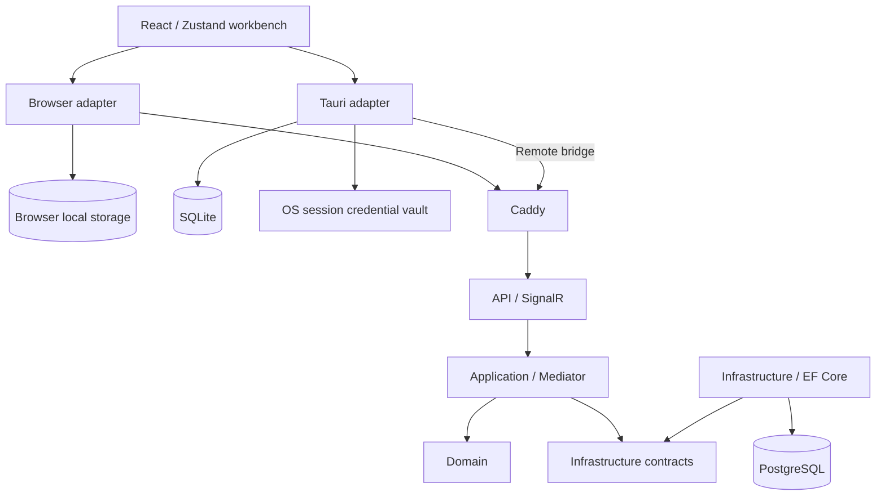

# Architecture and data flow

PakPost serves a shared React workbench through Vite in development or a Node static server in production. Caddy exposes one origin and routes `/api`, `/hubs` and `/health` to ASP.NET Core. The API and static server are on a private Compose network, with .NET chiseled and Node distroless runtimes.

## Request execution

Browser direct mode is subject to browser CORS. The extension interceptor offers an optional browser bridge; Secure Proxy executes permitted requests at the backend. Native HTTP executes requests from the desktop host, including internal destinations deliberately chosen by the user. Cancellation stops the client-side operation where supported, not a transaction already accepted by the upstream. Request timing currently does not guarantee separate DNS/TCP/TLS measurements.

Pre/post scripts run via QuickJS in a worker, with time, memory and output limits. The `pm.*` facade is a compatibility subset. Runner iteration data and variable propagation are supported, with JSON/JUnit reports. Treat imported scripts as untrusted.

## Collaboration and security boundaries

Cloud data is stored in PostgreSQL. Workspace membership and permissions are checked server-side. Workspace envelope encryption uses a workspace DEK wrapped by the configured master key; separate legacy encryption material is retained for compatibility. Browser sessions use cookies and CSRF; desktop remote sessions use native Rust handling. Persistent Data Protection keys support ASP.NET Core protected state, distinct from workspace encryption keys.

Realtime events are delivered by SignalR, with native WebSocket transport and Long Polling/REST fallback in desktop. Clients refresh authorized resources after events. Member removal revokes future access; already-downloaded data cannot be recalled. Realtime delivery is best-effort and the current connection registry is scoped to one backend instance. The architecture is not a multi-instance deployment contract.

See [security](security.md) for controls and limitations and [configuration](configuration.md) for runtime settings.
